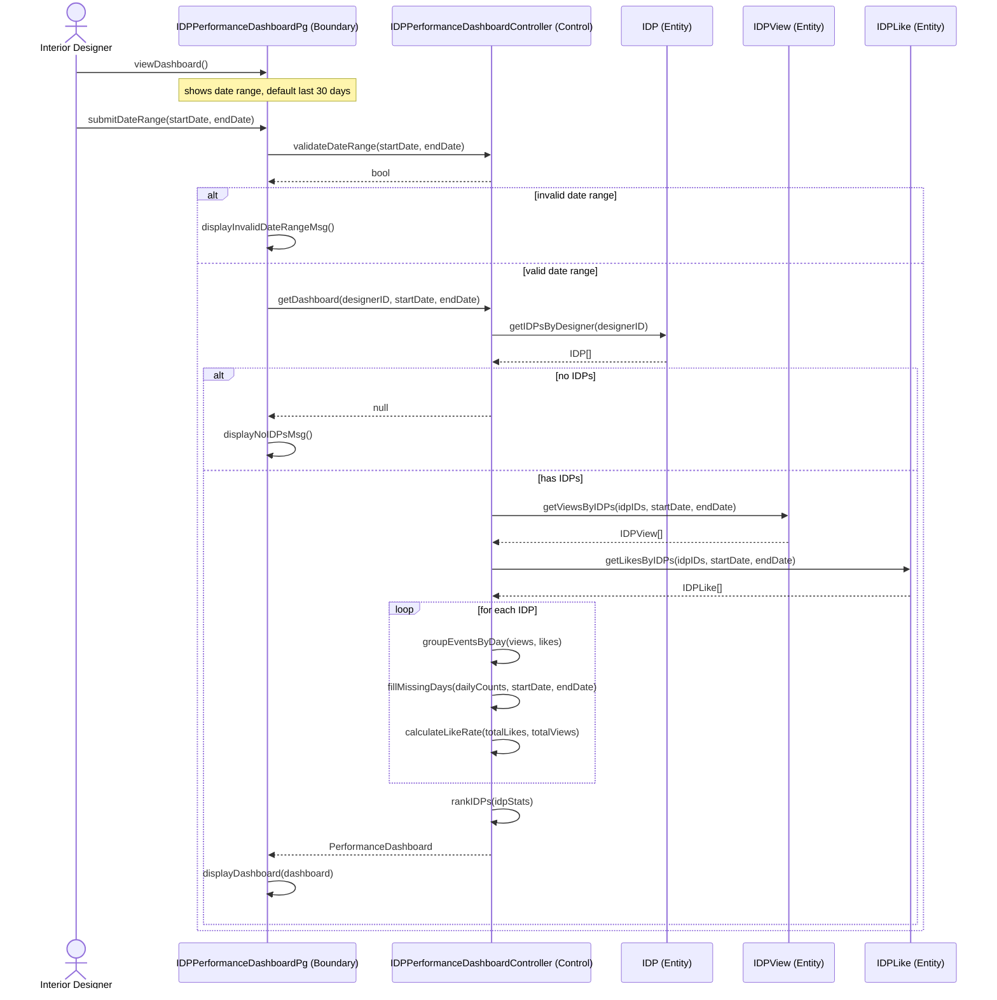

# IDP Performance Dashboard (ID17): aligned design

This replaces the class and sequence diagrams in the "final ID(4 features)" tab of the group doc.
It uses the repo's class names (`IDPPerformanceDashboardPg`, `IDPPerformanceDashboardController`)
and the existing entities (`IDP`, `IDPView`, `IDPLike`) instead of `viewIDDashboard*` / `IDDatabase` / `IdpEvent`.

- Class diagram: open `idp-performance-dashboard-class.drawio` in draw.io (app.diagrams.net) and export as PNG.
- Sequence diagram: the Mermaid code below. In draw.io use Arrange > Insert > Advanced > Mermaid, or it renders directly on GitHub.

## What changed from the doc's version

| Doc's diagram | Aligned design | Why |
|---|---|---|
| `viewIDDashboardPg`, `viewIDDashboardController` | `IDPPerformanceDashboardPg`, `IDPPerformanceDashboardController` | Matches the repo and the team naming convention |
| One `IDDatabase` entity with `getIDEvents()` returning an undefined `IdpEvent` | `IDP.getIDPsByDesigner`, `IDPView.getViewsByIDPs`, `IDPLike.getLikesByIDPs` | These are the real tables (`idp`, `idp_view`, `idp_like`) |
| Events fetched without fetching the IDPs | IDPs fetched first, then their events | Otherwise an IDP with 0 views and 0 likes is missing from the ranking, and "no IDPs" is confused with "no events" |
| No date validation | `validateDateRange` plus an alt frame | Covers alternative flow 3a |
| `flash(str, str)`, `str`, `dict`, `List<...>` | `displayInvalidDateRangeMsg()`, `displayNoIDPsMsg()`, `String`, `int`, `IDP[]` | `flash` is Flask, not Next.js; types now match the other diagrams and the code |
| `calculateLikeRate(viewCount, likeCount)` | `calculateLikeRate(likes, views)` | Same order as the formula likes / views |
| `MAX_DASHBOARD_DAYS = 90` in the old repo skeleton | Removed | Not in the use case |

## Use case description (corrected)

| | |
|---|---|
| **Name** | View IDP Performance Dashboard |
| **Description** | An interior designer views a performance dashboard for their IDPs, showing daily views and likes, the like rate, and a ranking of which projects attract the most customer interest. |
| **Actor(s)** | Interior Designer |
| **Trigger** | Interior designer clicks "Performance Dashboard" on the dashboard menu. |
| **Pre-condition(s)** | The interior designer is logged in. |
| **Post-condition(s)** | The performance dashboard is displayed. The database is not changed. |
| **Normal flow** | 1. Interior designer clicks "Performance Dashboard" on the dashboard menu. 2. System displays the date range selection (default: last 30 days). 3. Interior designer selects a start date and an end date and clicks "View". 4. System retrieves the interior designer's IDPs from the IDP table in the database. 5. System retrieves the view events for those IDPs within the date range from the IDP view table, and the like events from the IDP like table. 6. The database returns the records. 7. System groups the view and like events by day for each IDP. 8. System fills in days with no activity with 0 views and 0 likes. 9. System calculates the like rate (likes divided by views) for each IDP. 10. System ranks the IDPs by total likes, using total views to break ties. 11. System displays the dashboard with the daily views and likes chart, like rate, and ranking. |
| **Alternative flow(s)** | 3a. End date is before the start date: system displays "Invalid date range". Flow returns to step 3. 4a. The interior designer has no IDPs: system displays "You have no projects yet", and the use case ends. 9a. An IDP has 0 views in the date range: system shows its like rate as 0% instead of dividing by zero. |

Changes: the pre-condition no longer says "has at least one IDP" (it contradicted 4a), and step 5 names the
real view and like tables instead of an "IDP event table".

## Sequence diagram

